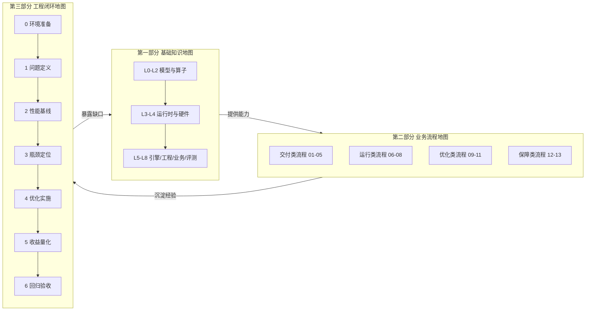
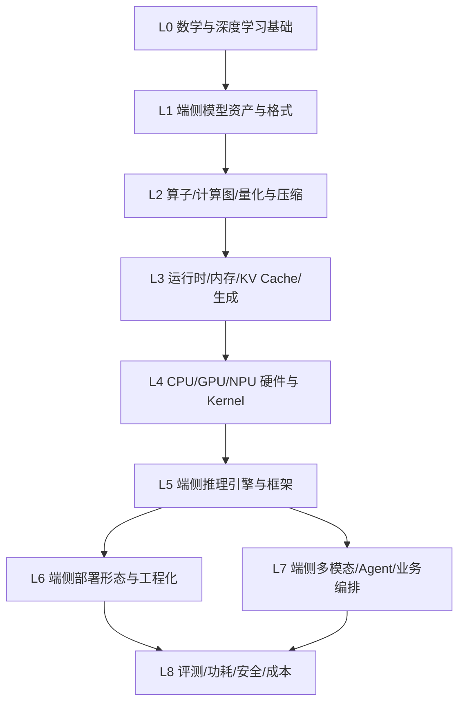

# 端侧大模型推理业务地图

> **用途**：把端侧大模型推理从「知识」到「流程」再到「持续交付能力」串成一张可执行的地图，用于系统学习、实践规划、团队分工与能力评估。
>
> **边界**：**只覆盖端侧**（手机 / PC / 平板 / 嵌入式 / IoT / 车载 / 机器人等单设备或近设备场景）。数据中心的多卡多机并行、集群调度、K8s 平台、多租户云服务、按 token 计费不在本图范围内；端云协同仅保留「卸载边界判定」这一个决策点。
>
> **三图一体**：本业务地图由三部分组成，三张图回答三个不同问题——
>
> | 部分              | 视角         | 回答的问题        | 类比    | 内容来源           |
> | --------------- | ---------- | ------------ | ----- | -------------- |
> | **第一部分 基础知识地图** | 知识维度（纵向分层） | **我要掌握什么**   | 一张地形图 | 知识地图 L0–L8     |
> | **第二部分 业务流程地图** | 流程维度（横向流动） | **事情怎么跑起来**  | 一条流水线 | 知识地图「二、业务流程地图」 |
> | **第三部分 工程闭环地图** | 闭环维度（迭代反馈） | **团队如何持续交付** | 一个飞轮  | 知识地图「三、工程闭环地图」 |

---

## 0. 总览：三图如何咬合



- **知识地图**提供「能力原料」：没有 L0–L8 的知识储备，流程跑不动；
- **流程地图**是「能力的使用现场」：把知识组合成可执行的端到端链路；
- **工程闭环地图**是「能力的进化机制」：流程中暴露的问题回流成知识缺口，驱动下一轮迭代。

---

# 第一部分 · 基础知识地图

> **一句话**：端侧推理的知识是一摞**有依赖顺序的层**，从数学到硬件再到工程，下层不理解就无法真正掌握上层。

## 1.1 分层依赖



## 1.2 分层能力表

| 层级 | 主要问题                  | 核心产出                                     | 验收要点                  |
| -- | --------------------- | ---------------------------------------- | --------------------- |
| L0 | 模型为什么这样计算、端侧为何受限      | 估算任意小模型的算量、权重、KV Cache 与带宽需求             | 能给指定模型的端侧内存预算与带宽下界    |
| L1 | 模型如何被压缩、打包和加载到端侧      | 把模型转成端侧格式并校验体积、精度、加载路径                   | 完成"选型→压缩→转换→校验"闭环     |
| L2 | 算子/图/量化如何在端侧表达与执行     | 实现并测试核心算子，完成端侧量化与压缩                      | 精度/体积/速度/功耗四维选型并验证    |
| L3 | 如何高效、稳定地跑一次生成         | 图执行、内存规划、KV Cache、流式生成、投机解码              | 内存上限内稳定运行，给可复现基线      |
| L4 | 如何压榨 CPU/GPU/NPU 获得性能 | SIMD/Kernel、异构调度、Profile 定位瓶颈            | 两种后端对比，量化时延/内存/功耗收益   |
| L5 | 用哪个引擎、如何选型与调优         | 对 llama.cpp/MNN/ncnn/TFLite/CoreML 等选型调优 | 给出可辩护的选型与调优方案         |
| L6 | 如何集成到设备并稳定运行          | App/固件集成、模型分发、OTA、启动与体积优化                | 从"能跑"到"可分发/可更新/可稳定运行" |
| L7 | 如何解决真实端侧业务问题          | 端侧多模态、端侧 Agent、本地 RAG                    | 端到端跑通并满足时延/内存/功耗预算    |
| L8 | 如何稳定、低功耗、隐私合规地运营      | 质量/性能/功耗评测、观测、安全与能效闭环                    | 建立四维评测与能效闭环           |

---

## 1.3 L0：数学、深度学习与 Transformer 基础（端侧视角）

**学习目标**：从数学和模型结构层面解释一次 Token 生成，并**从端侧约束出发**估算计算量、内存、带宽与数值误差来源。

**核心知识**

- 向量/矩阵/张量/转置/广播/范数、低秩分解（端侧压缩基础）；
- 概率分布、Softmax、交叉熵、采样；
- 浮点与低比特：FP32/FP16/BF16/FP8(E4M3/E5M2)/INT8/INT4/INT2/NF4/MXFP4；
- 舍入、溢出、累加精度、定点/浮点误差传播（端侧低比特核心风险）；
- Transformer、残差、归一化、激活函数；
- Self-Attention、MHA/GQA/MQA/Cross-Attention；RoPE、位置编码、因果 Mask；
- FFN、SwiGLU/GeGLU/ReGLU；Encoder-only/Decoder-only/Encoder-Decoder、MoE；
- Prefill 与 Decode 的计算特征（端侧 Decode 几乎必然 memory-bound）；
- **端侧特有**：参数量与设备内存匹配、规模-质量曲线、token/s 一阶估算。

**端侧必须回答的问题**

1. 为什么端侧 Decode 几乎总是**内存带宽受限**而非算力受限？
2. 给定层数/Hidden/KV Heads/序列长度，KV Cache 在 FP16/INT8/INT4 下分别多大？
3. 为什么端侧偏好小模型 + 激进量化，而非大模型 + 高精度？
4. 为什么端侧累加必须用比输入更高的精度（INT4 权重配 INT8/FP16 累加）？
5. 同一模型在 CPU/GPU/NPU 三后端为何输出不同？误差从哪来？
6. 3B 模型在 8GB 手机上的内存预算如何切分？

**实践产出**：手算单层 Attention 形状与带宽需求；NumPy 实现单头 Attention/RoPE/RMSNorm/Greedy Decode；绘制 Prefill/Decode 数据流并标注瓶颈；建立 0.5B/1.5B/3B/7B 内存估算表。

**验收标准**：不依赖框架解释一次 Token 从输入到 logits 的完整计算过程，并对指定模型给出可信的端侧内存预算与带宽/时延下界估算。

---

## 1.4 L1：端侧模型资产、权重、Tokenizer 与模型格式

**学习目标**：判断模型资产是否适合端侧，理解规模选择、结构剪裁、权重打包、Tokenizer 与端侧格式之间的契约。

**4.1 结构与规模选择**

重点字段：`n_layer`、Hidden Size、Attention/KV Head 数、Head Dim、Intermediate Size、Vocab Size、Context Length、RoPE 参数、激活与归一化、MoE Expert/Top-K/共享 Expert、Sliding Window。

| 配置                 | 端侧主要影响                           |
| ------------------ | -------------------------------- |
| 层数                 | 权重规模、逐层带宽、Decode 时延              |
| Hidden Size        | 矩阵乘法规模、激活内存                      |
| KV Heads (GQA/MQA) | KV Cache 大小与 Attention 带宽（端侧最敏感） |
| Context Length     | 最大上下文与 KV Cache 上限、内存墙           |
| Vocabulary Size    | 输出层算量、词表嵌入体积                     |
| Expert/Top-K       | MoE 权重总量与端侧可用性                   |

端侧规模档位：0.5B / 1.5B / 3B / 7B / 14B ↔ 入门手机 / 旗舰手机 / PC / 工作站。

**4.2 端侧模型格式**

| 格式                    | 代表引擎                    | 典型设备              | 特点                  |
| --------------------- | ----------------------- | ----------------- | ------------------- |
| GGUF                  | llama.cpp / ggml        | CPU/GPU 全平台       | 单文件、自带量化类型、mmap 友好  |
| ONNX                  | ONNX Runtime / OpenVINO | 全平台               | 图 IR 通用，量化需额外工具链    |
| TFLite / LiteRT       | TFLite / MediaPipe      | Android/iOS       | 移动端生态成熟，Delegate 机制 |
| Core ML (`mlpackage`) | Apple Core ML           | Apple 全系          | 可编译到 ANE，系统级调度      |
| MLX                   | Apple MLX               | Apple Silicon     | 统一内存友好              |
| NCNN (`.param/.bin`)  | ncnn                    | Android/iOS/嵌入式   | 轻量、无第三方依赖           |
| MNN                   | MNN                     | Android/iOS/嵌入式   | CPU/GPU/NPU 后端齐全    |
| RKNN                  | RKNN Toolkit            | Rockchip NPU      | 面向瑞芯微 NPU 离线编译      |
| QNN / DLC             | Qualcomm QNN / SNPE     | 骁龙 NPU/DSP        | 高通 AI Engine Direct |
| ExecuTorch (`.pte`)   | ExecuTorch              | 移动/嵌入式            | PyTorch 官方端侧导出      |
| OpenVINO IR           | OpenVINO                | Intel CPU/GPU/NPU | x86 边缘与 AI PC       |
| TensorRT Engine       | TensorRT(-LLM)          | Jetson/Orin       | NVIDIA 边缘设备         |
| TVM / MLC             | TVM / MLC-LLM           | 多后端               | 编译式，跨硬件             |

**4.3 权重打包与加载**：Tensor 名称/形状/dtype/偏移/对齐/分片；mmap 与按需分页（端侧冷启动与内存关键）；权重去重、tie embedding；转置/重排/预打包；全量 vs 分页 vs 逐层加载；校验、版本兼容、完整性。

**4.4 模型压缩**：量化（详见 L2）；剪枝（非结构化/结构化/半结构化 N:M）；知识蒸馏；低秩分解；权重共享/词表裁剪；层裁剪。

**4.5 Tokenizer 与对话模板**：BPE/SentencePiece/Unigram/WordPiece/Byte-level BPE；Vocabulary/Merge Rules/Token ID/控制 Token；UTF-8/Unicode/中文/Emoji；Chat Template。常见陷阱：词表不匹配、模板错误、中文/Emoji 分词异常、上下文估算偏差导致 KV 溢出 OOM。

**实践产出**：模型元数据与体积检查器；Tokenizer encode/decode 与计数；HF→GGUF/ONNX/TFLite/CoreML 转换；转换前后一致性校验。

**验收标准**：独立完成"选型→压缩→转换→校验"闭环，并给出体积、精度、加载时间的量化对比。

---

## 1.5 L2：端侧 Tensor、算子、计算图、精度与量化

**学习目标**：实现端侧小型推理图，理解布局、算子契约、内存访问，并在端侧约束下选择量化与压缩方案。

**5.1 Tensor 与布局**：Shape/Stride/Contiguous/View；Reshape/Transpose/Permute/Broadcast；Row/Column-major、对齐、Padding、Block Layout；与 SIMD/NPU 对齐的打包布局、量化 block 布局、NCHW/NHWC；Host/Device Buffer、统一内存（UMA）与零拷贝；张量的输入/输出/临时/权重属性。

**5.2 核心算子**：MatMul/GEMM/Batched MatMul/**GEMV（Decode 主力）**；Embedding Lookup/Gather/Scatter；RMSNorm/LayerNorm；Softmax/Mask；RoPE；Attention/FlashAttention/Paged Attention；SwiGLU/GeGLU；Add/Mul/Scale/Copy/Concat；Reshape/View/Permute/Transpose；Top-K/Argmax/采样；Quantize/Dequantize/**量化矩阵乘（Q4×Q8 混合精度）**。

每个算子记录：输入输出形状、精度（含量化类型）、Stride/布局、能否原地、临时工作区、计算复杂度、**内存访问量（端侧最关键）**、后端支持矩阵、误差容忍度。

**5.3 计算图**：节点/边/叶子/拓扑排序；图分区、**设备放置与算子回退（CPU fallback）**；Constant Folding/DCE；Operator Fusion/Layout Transform（端侧减访存核心手段）；静态 Shape 优先；执行计划与图捕获。

**5.4 量化（端侧重头戏）**

- PTQ/QAT、动态/静态量化；对称/非对称；Per-Tensor/Channel/Group/Token；
- Weight-only（W4A16/W3A16）、W8A8、W4A8；Scale/Zero Point/Quantization Block（block-wise 是端侧主流）；
- GPTQ/AWQ/SmoothQuant/HQQ/AQLM/imatrix 校准；
- 类型体系：INT8/INT4/INT2-3/NF4/FP8/MXFP4 及 ggml K-Quant（Q4_K_M/Q5_K/Q6_K…）；
- **KV Cache 量化**（端侧长上下文关键手段）。

端侧评估同时看：Perplexity/任务准确率/长上下文/多语言代码；首 Token 延迟/Decode 速度；**峰值内存/体积/功耗/温度**；后端支持矩阵。

**5.5 稀疏化与压缩**：非结构化稀疏（硬件收益有限）；结构化/半结构化（N:M，需硬件/Kernel 支持）；权重共享、低秩、蒸馏后的结构改造；稀疏与量化的组合顺序。

**实践产出**：CPU 实现 MatMul/RMSNorm/Softmax/RoPE；简化计算图与内存复用器；F16/BF16/INT8/INT4/Q4_K_M 误差与性能对比；量化算子 reference/kernel 一致性测试；量化选型报告。

**验收标准**：能在给定端侧设备上，从精度、体积、速度、功耗四个维度选择并验证一套量化+压缩方案。

---

## 1.6 L3：端侧推理运行时、内存、KV Cache 与生成

**学习目标**：构建可重复执行、可控内存、支持流式生成、**在端侧内存约束下不 OOM** 的本地运行时。

**6.1 Prefill/Decode（端侧特征）**：Prefill 计算密集、决定 TTFT；Decode 内存带宽密集、决定 ITL/tok/s。端侧必须观测：Prompt Token 数、Prefill 时间、首 Token 时间、Decode 每 Token 时间、输出 Token 数、总耗时、**峰值内存**、**平均功耗**。

**6.2 端侧内存模型**

```text
模型权重 + KV Cache + 中间激活 + 临时 Workspace + 输入输出 Tensor + 运行时元数据
```

- 统一内存/共享内存（CPU/GPU/NPU 共享物理内存）；
- App 内存配额：iOS Jetsam 强杀、Android LMK 回收、后台限制；
- Arena/Memory Pool/Workspace、Tensor Lifetime 与复用；
- mmap、按需分页、Pinned Memory、零拷贝；
- 逐层加载/权重 Streaming（大模型跑小内存设备）；
- 内存不足时的降级策略（降上下文、降量化、回退小模型）。

**6.3 KV Cache（端侧最敏感）**

```text
层数 × 序列长度 × KV Heads × Head Dimension × 元素大小 × 2
```

K/V Cache、Cache Slot/Position/生命周期；Paged Attention；Prefix/Prompt Cache（多轮复用）；**KV Cache 量化与压缩**（INT8/INT4、低秩、Token 合并/驱逐）；Sliding Window、StreamingLLM（注意力池）；Cache Eviction/TTL/优先级；内存预算下动态分配与回收。

**6.4 Sampling 与生成控制**：Greedy/Temperature/Top-K/Top-P/Min-P；Repetition/Frequency/Presence Penalty；Stop Token/Logit Bias；Grammar/JSON Schema；函数与工具调用；**投机解码**（Draft Model、n-gram/检索草稿、接受率；端侧草稿模型也占内存与功耗，需评估净收益）。

**实践产出**：单请求 Prefill/Decode 循环；KV Cache 分配/复用/量化/淘汰；流式输出与取消；约束采样；真机内存峰值/tok/s/功耗/温度报告。

**验收标准**：能在指定端侧设备上，使目标模型在内存上限内稳定运行，并给出可复现的时延/内存/功耗基线。

---

## 1.7 L4：端侧 CPU、GPU、NPU、DSP 与 Kernel 优化

**学习目标**：根据端侧硬件特性选择布局、Kernel 与并行/异构策略，用端侧工具定位瓶颈（带宽/算力/功耗/热）。

**7.1 CPU（端侧主力后端）**

- **ARM**：NEON、dotprod（SDOT/UDOT）、i8mm（SMMLA）、BF16（BFDOT）、SVE/SVE2、SME、Arm KleidiAI；
- **x86**：SSE/AVX/AVX2/AVX-512（VNNI、BF16）、AMX（AI PC）；
- **RISC-V**：RVV 1.0；
- Cache 层级、大小核（big.LITTLE）、NUMA、线程绑定与亲和性；
- SIMD/Tiling/Blocking/Prefetch/循环展开；OpenMP/pthread/BLAS、大核优先调度；
- 内存带宽、Cache Miss、伪共享、量化 vec_dot。

**7.2 GPU（移动/集成）**

- Qualcomm Adreno、Arm Mali、Imagination PowerVR、Apple GPU；
- Vulkan Compute、OpenCL、Metal、WebGPU、OpenGL ES Compute；
- Thread/Warp/Wave、Subgroup、Shared/Global Memory、Coalesced Access；
- 统一内存与零拷贝、Tile-Based（TBDR）特点；
- Kernel 启动开销（端侧对大量小 Kernel 极敏感）、命令缓冲；
- 端侧 GPU 更适合 Prefill/大矩阵，Decode 常被带宽与启动开销限制。

**7.3 NPU / DSP / 专用加速器**

- Apple ANE（Core ML 编译到 ANE）；Qualcomm Hexagon NPU(HTP)/DSP（QNN/AI Engine Direct）；
- MediaTek APU、Samsung NPU、Huawei Da Vinci（昇腾/CANN）；
- Rockchip RKNPU、Google Edge TPU/Coral、NXP eIQ Neutron、地平线 BPU（车载）、寒武纪；
- 算子支持矩阵、图分区、CPU/GPU Fallback；离线编译、设备内存与数据格式约束；
- 量化要求（多数 NPU 只吃 INT8/INT16/定点，部分支持 INT4）；动态 Shape 支持度、初始化、错误恢复、版本兼容；
- "能效优势 vs 灵活性劣势"取舍。

**7.4 异构计算与调度**：CPU+GPU+NPU 三方分工（按算子/阶段）；算子级 offload 与回退；统一内存零拷贝与同步；大小核/GPU/NPU 功耗与热预算下动态调度；单设备内多线程+SIMD+异构（**不是**多卡多机）。

**7.5 端侧性能模型**：区分 Compute Bound / **Memory Bound（Decode 常态）** / **Launch Bound** / **Power·Thermal Bound（端侧独有）** / IO Bound。用 FLOPS/MACs/Arithmetic Intensity/Bandwidth/Roofline 分析；端侧额外引入**能效（tokens/Joule）与热稳态**。

**实践产出**：ARM NEON 或 GPU 的 MatMul/RMSNorm/量化 GEMV；多 Batch/序列/dtype/后端性能与功耗对比；perf/Arm Streamline/Snapdragon Profiler/Xcode Instruments/Perfetto Profile；性能下降根因报告。

**验收标准**：能在至少两种端侧后端（如 CPU 与 NPU）上完成同一模型的优化与对比，量化给出时延、内存、功耗三项收益。

---

## 1.8 L5：端侧推理引擎与框架

**学习目标**：根据设备、模型、业务选择端侧推理引擎，完成部署、调优与跨引擎对比。

**8.1 主流引擎**

| 引擎                          | 出品           | 强项                         | 典型场景            |
| --------------------------- | ------------ | -------------------------- | --------------- |
| llama.cpp / ggml            | 社区           | 全平台 CPU/GPU，量化类型最全         | 桌面/手机/嵌入式 LLM   |
| MNN                         | 阿里           | 移动端 CPU/GPU/NPU，端侧 LLM/多模态 | Android/iOS App |
| ncnn                        | 腾讯           | 极轻量、无依赖、ARM 优化强            | 移动/嵌入式 CV 与 LLM |
| TNN                         | 腾讯           | 移动端多后端                     | App 内推理         |
| TFLite / LiteRT / MediaPipe | Google       | Android 生态、Delegate 机制     | Android 移动端     |
| ONNX Runtime                | Microsoft    | 跨平台、EP 可插拔                 | 全平台通用           |
| ExecuTorch                  | Meta/PyTorch | PyTorch 官方端侧导出             | 移动/嵌入式          |
| Core ML / MLX               | Apple        | ANE 加速、系统级调度               | Apple 全系        |
| OpenVINO                    | Intel        | x86/边缘/AI PC、NPU           | 边缘 PC/工业        |
| TensorRT / TensorRT-LLM     | NVIDIA       | Jetson/Orin 边缘加速           | 机器人/边缘服务器       |
| QNN / AI Engine Direct      | Qualcomm     | 骁龙 NPU/DSP 深度优化            | 骁龙手机/XR/车机      |
| RKNN / SNPE / Paddle Lite   | 各厂商          | 特定 SoC 优化                  | 对应硬件            |
| TVM / MLC-LLM               | 社区           | 编译式跨硬件                     | 研究/定制后端         |
| WebLLM / WebGPU / WebNN     | 社区           | 浏览器内推理                     | Web 端           |


**8.2 选型矩阵维度**：后端覆盖（CPU/GPU/NPU）、量化类型、动态 Shape、多模态、流式输出、内存峰值、冷启动、包体积、易用性、社区活跃度、许可证。

**8.3 引擎通用机制**：模型加载与 mmap；图优化与算子融合；后端（Backend/Delegate/EP）抽象与回退；线程池与调度；内存池与工作区；采样与流式接口；端侧 LLM 专属（KV Cache 管理、投机解码、多轮缓存）。

**实践产出**：≥2 个引擎部署同模型对比；为引擎编写自定义算子/后端扩展；引擎选型报告。

**验收标准**：能基于设备画像与业务约束，给出可辩护的引擎选型与调优方案。

---

## 1.9 L6：端侧部署形态与工程化

**学习目标**：把端侧引擎集成进真实设备与产品，处理分发、启动、体积、更新与稳定性。

**9.1 部署形态**：移动端 App（iOS/Android，动态库集成、模型随包/按需下载）；PC/AI PC（Windows/macOS/Linux 桌面与本地助手）；嵌入式/IoT（可能仅几十 MB 内存，TinyML）；车载/机器人/XR（实时性、功能安全、热与功耗）；浏览器端（WebGPU/WebNN/WASM）。

**9.2 工程化要点**：模型打包/压缩/加密与体积控制；分发与按需下载、增量更新、OTA；冷启动优化（首帧加载、mmap、预热）；线程/核心调度与后台策略（避免被系统杀）；多设备适配（不同 SoC/内存档位分发）；模型版本管理与回滚；端云边界决策（仅做判定，不展开云端）。

**实践产出**：一次 App/桌面集成（含加载与流式 UI）；按需下载与 OTA；冷启动/包体积/峰值内存优化报告。

**验收标准**：能把一个端侧模型从"能跑"推进到"可分发、可更新、可长期稳定运行"。

---

## 1.10 L7：端侧多模态、Agent 与业务编排

**10.1 端侧多模态**：视觉（ViT/图像编码器/Patch/图像 Token/OCR）；语音（ASR/TTS/音频编码器/实时语音助手）；视频（帧采样/时序建模）；跨模态投影与对齐；分辨率/Token 数/KV Cache 权衡；算力与内存分配（视觉编码器常是瓶颈）。

**10.2 端侧 Agent 与工具调用**：任务拆解/规划/执行/反思/状态管理（全本地）；本地工具（日历/通讯录/系统 API/本地搜索）；函数调用/参数 Schema/权限/超时/重试/循环检测；必须控制每步推理次数、上下文增长、最大执行时长、权限边界；"小模型 + 工具"组合策略。

**10.3 端侧 RAG 与本地知识**：本地文档解析/切分/Embedding（端侧小 embedding 模型）；本地向量库/关键词检索（ANN/BM25）；本地 Reranker/Query Rewrite；隐私（数据不出端）；上下文与 KV 预算下的检索策略。

**实践产出**：端侧图文/语音到结构化输出链路；带本地工具的端侧 Agent；端侧 RAG Demo。

**验收标准**：能在目标设备上端到端跑通一个多模态或 Agent 业务，并满足时延、内存、功耗预算。

---

## 1.11 L8：评测、可观测性、功耗、安全与成本

**11.1 质量评测**：模型能力（Perplexity/MMLU/GSM8K/HumanEval/长文本/多语言/多模态/领域集；人工/LLM-as-a-Judge）；端侧推理质量（Tokenizer/Template 正确性；权重完整性；算子数值一致性；**量化前后质量**；多后端一致性；Stop/JSON/Tool Call/Streaming 正确性；Prefix Cache 命中前后一致性）。

**11.2 性能与能效指标**

| 类别 | 指标                                      |
| -- | --------------------------------------- |
| 延迟 | TTFT、ITL、E2E、P50/P95/P99                |
| 速度 | Decode tok/s、Prefill tok/s、人类阅读速度比      |
| 内存 | 权重体积、峰值 RSS、KV Cache、激活、App 配额占用        |
| 功耗 | 瞬时/平均功率 (mW/W)、**能效 tokens/Joule**、续航影响 |
| 热  | SoC 温度、降频点、持续负载稳态性能                     |
| 启动 | 冷启动、首帧、模型加载时间                           |
| 缓存 | Prefix Cache 命中率、KV Cache 使用率           |

**11.3 端侧可观测性工具**：移动端（Xcode Instruments Energy/Metal/ANE、Android Studio Profiler、Perfetto/systrace、Snapdragon Profiler、Arm Streamline、Mali Offline Compiler）；桌面/边缘（perf/top/VTune/Nsight/Apple Instruments）；通用（Tracy/Chrome Trace/自定义埋点）。日志含：设备型号、SoC、内存档位、后端、量化类型、Token 数、TTFT、tok/s、峰值内存、功耗/温度、错误码。

**11.4 可靠性与稳定性**：OOM 与被系统强杀（Jetsam/LMK）；算子不支持与回退；热降频导致性能抖动；取消/超时/中断恢复；加载失败与版本不兼容；长跑资源泄漏、KV 泄漏、上下文污染。

**11.5 安全与隐私**：隐私（数据不出端、本地处理、差分隐私、用户数据隔离）；输入侧（Prompt Injection/Jailbreak/超长输入/Unicode 混淆/恶意 JSON/工具参数注入）；输出侧（PII 脱敏/敏感过滤/结构化校验/工具权限）；模型资产（模型加密、权重完整性、TEE/安全执行环境）；设备侧（沙箱/权限/密钥管理/固件依赖安全）。

**11.6 成本与商业指标（端侧口径）**

```text
设备硬件成本（一次性，摊销）+ 功耗与电池寿命损耗
+ 模型体积与分发/存储成本 + App 体积与安装门槛 + 研发维护成本
```

核心指标：每设备/每用户摊销成本；**能效与续航影响**；峰值内存与设备覆盖范围；量化/压缩收益；冷启动与首屏成本；端云边界的成本与隐私权衡。

---

# 第二部分 · 业务流程地图

> **一句话**：知识是静态的，业务是流动的。这一部分把 L0–L8 的知识组合成**可执行的端到端链路**。

## 2.1 四类核心流程

| 类别      | 编号与流程           | 何时进入                      | 主要产出            |
| ------- | --------------- | ------------------------- | --------------- |
| **交付类** | 01 模型选型与部署规划    | 新业务、新设备或更换模型              | 选型结论、资源预算、部署方案  |
|         | 02 模型上线与交付      | 方案确定，准备交付                 | 可部署版本、验收结论、回滚方案 |
|         | 03 硬件与推理后端适配    | 新硬件、OS、驱动、Runtime 或后端     | 兼容性结论、适配清单      |
|         | 04 模型质量评测与验收    | 模型、量化、后端或配置变化             | 质量报告、放行结论       |
|         | 05 AI 应用链路交付    | 涉及 RAG、Agent、工具调用或多模态     | 端到端验证结果、应用发布包   |
| **运行类** | 06 在线请求处理       | 推理请求执行与返回                 | 请求结果、用量与 Trace  |
|         | 07 线上监控与容量治理    | 日常运行、流量变化或告警              | 运行状态、容量与告警策略    |
|         | 08 内存与缓存治理      | OOM、内存增长、KV Cache 或长上下文问题 | 内存预算、缓存策略、治理结论  |
| **优化类** | 09 性能分析与优化      | 时延、吞吐、功耗或资源指标不达标          | 瓶颈结论、优化收益对比     |
|         | 10 版本迭代与回归      | 模型、引擎、Kernel、驱动或配置升级      | 回归结果、灰度/回滚结论    |
|         | 11 成本、能效与业务价值优化 | 单请求成本、能耗或资源利用率不理想         | 成本收益分析、优化决策     |
| **保障类** | 12 故障定位与恢复      | 崩溃、超时、输出异常或服务不可用          | 根因、修复验证、预防措施    |
|         | 13 安全、隐私与可靠性治理  | 上线审查、风险发现或安全事件            | 风险清单、整改与审计结论    |

## 2.2 流程关系图

```text
业务需求
  └─ 01 选型与部署规划
       ├─ 03 硬件/后端适配
       ├─ 04 质量评测与验收
       └─ 02 上线与交付
            ├─ 05 AI 应用链路（按需）
            └─ 06 请求处理 → 07 监控与容量治理
                          └─ 08 内存与缓存治理

运行数据 → 09 性能分析与优化 → 11 成本与能效优化（按需）
         └→ 12 故障定位与恢复（异常时）

模型/引擎/Kernel/驱动/配置变更 → 10 版本回归 → 04 质量验收 → 发布或回滚

13 安全、隐私与可靠性治理：贯穿选型、交付、运行与版本变更
```

## 2.3 常用路径

| 场景        | 建议路径                                 |
| --------- | ------------------------------------ |
| 从零交付模型    | 01 → 03/04 → 02 → 06/07；涉及应用编排时加入 05 |
| 推理变慢或资源异常 | 07/08 → 09；若出现崩溃、错误或超时，进入 12         |
| 升级模型或引擎   | 10 → 04 → 灰度发布/回滚                    |
| 降低成本与功耗   | 07/09 → 11，并复核质量和稳定性                 |
| 端侧项目上线    | 按需检查 13；端云协同、离线降级等作为专项子流程            |

## 2.4 学习建议

对于端侧大模型推理优化工程师，不建议平均学习所有流程，应优先深入以下核心流程：

| 优先级 | 重点流程      | 学习目标                             |
| --- | --------- | -------------------------------- |
| P0  | 性能分析与优化   | 定位时延、吞吐、内存、功耗瓶颈并完成优化闭环           |
| P0  | 故障定位与恢复   | 分析模型、Runtime、硬件、系统问题并完成根因定位      |
| P0  | 硬件与推理后端适配 | 掌握 CPU/GPU/NPU、Runtime、算子兼容与性能调优 |
| P0  | 模型质量评测与验收 | 建立质量、性能、资源综合验收标准                 |
| P0  | 版本迭代与回归   | 评估模型、引擎、Kernel、驱动变化影响            |

以上流程直接决定工程师是否具备独立解决端侧大模型推理实际问题的能力。

模型选型、上线交付、成本治理、安全治理等流程，可在掌握核心优化能力后逐步扩展。

---

# 第三部分 · 工程闭环地图

> **一句话**：从环境准备 → 问题定义 → Baseline → Profiling → 优化 → 验证 → 交付 → 资产沉淀，形成"发现问题 → 分析问题 → 解决问题 → 复制经验"的完整闭环。

## 3.1 业务闭环总览（7 步曲）

```text
定义问题与验收目标
        ↓
建立可复现基线
        ↓
定位瓶颈并形成证据
        ↓
设计并实施优化
        ↓
量化收益与风险
        ↓
回归验收、复盘与沉淀
        └──────────→ 下一轮优化
```

|  序号 | 阶段   | 一句话目标        | 关键交付               | 进入下一阶段的判据   |
| :-: | ---- | ------------ | ------------------ | ----------- |
|  0  | 环境准备 | 建立可复现推理环境    | 环境验证报告 / Demo 可跑   | 模型可稳定加载运行   |
|  1  | 问题定义 | 明确优化对象与验收标准  | KPI 指标表 / 验收标准     | 目标可量化、可验收   |
|  2  | 性能基线 | 建立优化前真实性能数据  | Baseline 报告 / 指标基线 | 数据可复现、覆盖场景全 |
|  3  | 瓶颈定位 | 找到真实瓶颈与根因    | Profile 报告 / 根因结论  | 根因明确、可归因    |
|  4  | 优化实施 | 模型/软件/硬件协同优化 | 优化版本 / 回滚方案        | 收益可测量       |
|  5  | 收益量化 | 客观验证优化收益与副作用 | 前后对比 / 权衡分析        | 收益达标且无质量回退  |
|  6  | 回归验收 | 确认可量产、可复制    | 验收报告 / 最佳实践        | 稳定、可规模化     |

## 3.2 阶段明细表（工程目标 · 活动 · 问题 · 输入 · 输出）

| 阶段         | 工程目标             | 核心工程活动                                                                                             | 解决的问题               | 关键分析内容                                                                                                                                                                                                                                  | 主要输入                       | 主要输出物                                              |
| ---------- | ---------------- | -------------------------------------------------------------------------------------------------- | ------------------- | --------------------------------------------------------------------------------------------------------------------------------------------------------------------------------------------------------------------------------------- | -------------------------- | -------------------------------------------------- |
| **0 环境准备** | 建立可复现的端侧推理环境     | 设备连接 / SDK·驱动安装 / Runtime 部署 / 编译环境配置 / 模型加载验证 / Demo 运行验证                                         | 环境是否正确？模型能否稳定运行？    | **硬件**：CPU/GPU/NPU 信息、内存容量、算力<br />**软件**：OS、Driver、Runtime、Compiler 版本                                                                                                                                                                 | 设备信息、模型文件、SDK 工具链          | ①环境说明文档 ②编译配置 ③环境验证报告 ④Demo 运行版本                   |
| **1 问题定义** | 明确优化对象、业务目标与验收标准 | 确认模型版本 / 分析模型结构 / 确认设备环境 / 确认推理框架 / 制定性能指标                                                         | 优化什么？在哪优化？目标多少？     | **模型画像**：参数量、Transformer 结构、Attention 方式、Context 长度、KV Cache 需求<br />**设备画像**：CPU/GPU/NPU 架构、内存、带宽、功耗限制<br />**指标定义**：TTFT、Decode tok/s、Memory、Power、Accuracy                                                                           | 模型文件、设备信息、业务需求             | ①项目定义文档 ②模型画像 ③设备画像 ④KPI 指标表 ⑤验收标准                 |
| **2 性能基线** | 建立优化前真实性能数据      | 部署原始模型 / 搭建 Benchmark / 设计测试集 / 执行性能测试 / 采集系统数据                                                    | 当前性能到底是多少？          | **性能指标**：TTFT、Prefill Latency、Decode tok/s、E2E Latency、Memory Peak、Power、Temperature<br />**测试场景**：短输入短输出、长上下文、长生成、多轮对话、长时间运行                                                                                                           | 原始模型、测试脚本、设备环境             | ①Baseline 报告 ②Benchmark 测试集 ③性能数据库 ④指标基线           |
| **3 瓶颈定位** | 找到真实性能瓶颈与根因      | 拆解 E2E Latency / 分析 Prefill·Decode / Profiler 采集 / 算子分析 / CPU·GPU·NPU 分析 / 检查 Fallback 路径 / 分析数据搬运 | 为什么慢？慢在哪？根因是什么？     | **计算**：GEMM 热点、Attention 热点、Kernel 耗时、算子覆盖率<br />**硬件**：Compute/Memory Bound、带宽利用率、Cache 命中率、Thermal Throttling<br />**软件**：CPU fallback、Runtime 调度、Kernel 融合、Host-Device 同步                                                            | Baseline 数据、Profiler 数据、日志 | ①性能 Profile 报告 ②Hot Kernel 列表 ③执行路径分析 ④根因分析报告      |
| **4 优化实施** | 模型、软件、硬件协同优化     | 制定方案 / 模型转换 / 量化优化 / Graph 优化 / Kernel 优化 / Runtime 调优 / 内存优化                                      | 针对瓶颈采取什么优化？收益来源是什么？ | **模型层**：FP16/BF16、INT8/INT4、蒸馏、剪枝<br />**计算图层**：算子融合、Layout 优化、Constant Folding<br />**Kernel 层**：GEMM 优化、Attention Kernel、FlashAttention<br />**Runtime 层**：Memory Pool、KV Cache 优化、Batch 策略<br />**硬件层**：CUDA Kernel、NPU 算子、Thread 优化 | 瓶颈分析结果、优化目标、技术方案           | ①优化方案文档 ②模型优化版本 ③Runtime 配置 ④Kernel 修改 ⑤实验记录 ⑥回滚方案 |
| **5 收益量化** | 客观验证优化收益         | 相同环境复测 / 性能对比 / 收益分析 / 质量验证 / 资源分析                                                                 | 优化是否有效？是否有副作用？      | **性能收益**：TTFT 下降、Decode 提升、Latency 降低<br />**资源收益**：RAM 下降、功耗降低、温度改善<br />**质量验证**：Accuracy、输出一致性、任务效果                                                                                                                                  | 优化版本、Baseline 数据、测试环境      | ①优化前后报告 ②收益分析表 ③质量报告 ④性能资源权衡                       |
| **6 回归验收** | 确认版本可量产并形成资产     | 多场景测试 / 多设备验证 / 稳定性测试 / 产品验收 / 案例沉淀                                                                | 是否稳定？能否规模复制？        | **稳定性**：长时间运行、多输入长度、多设备、异常输入<br />**知识沉淀**：优化经验、配置参数、性能模型、问题案例                                                                                                                                                                          | 优化版本、测试报告、产品需求             | ①验收报告 ②回归报告 ③案例库 ④最佳实践                             |

---
