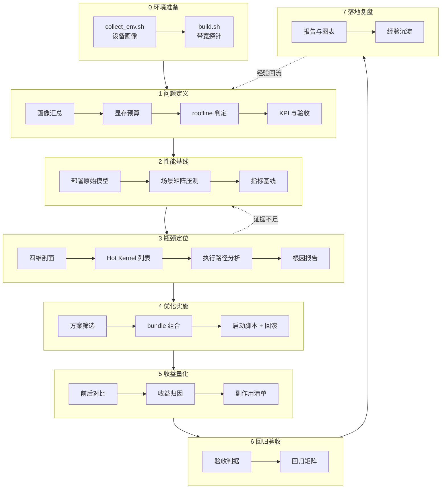

# perfkit · 大模型推理性能分析与优化框架

> **目标读者**：端侧/边缘大模型推理优化工程师、性能工程与部署团队  
> **前置知识**：Transformer 结构与 Prefill/Decode 差异、显存带宽与 roofline 概念、量化基础  
> **预计阅读**：15 分钟

把「端侧大模型推理业务地图」第三部分 · 工程闭环地图的 **7 步曲**固化成一套  
可执行框架：换模型、换硬件、换任务目标时**只改 YAML 配置，流程代码零改动**。

---

## 1. 七步闭环 ↔ 子命令

|  步  | 阶段   | 子命令                                           | 产出                                       |
| :-: | :--- | :-------------------------------------------- | :--------------------------------------- |
|  0  | 环境准备 | `scripts/collect_env.sh` + `scripts/build.sh` | 环境画像快照、带宽探针                              |
|  1  | 问题定义 | `perfkit define`                              | `definition.json`（画像/预算/roofline/KPI/对账） |
|  2  | 性能基线 | `perfkit baseline`                            | `baseline.json`                          |
|  3  | 瓶颈定位 | `perfkit profiling` + `perfkit diagnose`       | `profiling.json`（四维剖面 + Hot Kernel 列表）+ `diagnose.json`（根因报告） |
|  4  | 优化实施 | `perfkit optimize`                            | `optimize.json` + `start_optimized.sh`   |
|  5  | 收益量化 | `perfkit verify`                              | `verify.json`（对比 + 归因 + 副作用）             |
|  6  | 回归验收 | `perfkit report`（§6）+ 回归矩阵                  | `report.md` 的验收与回归章节                      |
|  7  | 落地复盘 | `perfkit report`（§7）+ `perfkit visualize`    | 复盘与案例沉淀 + `charts.html`                  |
|  —  | 辅助   | `perfkit probe` / `perfkit query`             | 带宽实测 / 跨运行查询                             |

一键串联：`perfkit all`（分析侧）或 `scripts/run_closure.sh`（含真机采集）。



---

## 2. 快速开始

```bash
# ① 框架自检（推荐先跑，确认公式与参考配置都正常；无需 GPU）
python3 scripts/selftest.py

# ② 采集环境画像（可选但推荐）
./scripts/collect_env.sh

# ③ 构建并自检带宽探针（可选但推荐）
./scripts/build.sh
./build/ggml_probe --mode all --size-gib 1 --rows 4096 --cols 4096

# ④ 跑完七步闭环（replay 模式，无需 GPU）
python3 -m perfkit all --run my-first-run

# ⑤ 看结果
open output/my-first-run/charts.html
cat  output/my-first-run/report.md
```

真机模式（需在目标设备上、且推理服务已启动）：

```bash
bash output/my-first-run/start_optimized.sh      # 按优化后配置启动 llama-server
python3 -m perfkit all --run my-run --mode live
```

> 装了 `make` 的话，`make help` 能看到全部快捷命令  
> （`make selftest` / `make closure` / `make probe` / `make charts` …）。

装技能包（可选，让 Claude 在相关任务上自动加载七步闭环方法论）：

```bash
ln -s "$(pwd)"/skills/* ~/.claude/skills/
python3 skills/validate_skills.py      # 校验
```

---

## 3. 目录结构

```text
ana/
├── README.md                    本文件
├── Makefile                     快捷命令（可选糖，所有命令都能直接跑）
├── configs/                     配置层（换模型/硬件/任务只改这里）
│   ├── model_qwen3.8-27b.yaml   模型画像：结构超参、量化档位、校准锚点
│   ├── device_rtx4090.yaml      设备画像：带宽/算力/功耗/约束
│   ├── task_decode_optimize.yaml 任务定义：KPI、验收、场景矩阵、复盘
│   ├── plan_q4km_mtp_kvq.yaml   优化方案库：方案卡片 + bundle 模板
│   └── qwen2.5-1.5b-cpu/        ★ 复用示例：x86 CPU 场景（含自带台账）
├── perfkit/                     框架层（七步流程代码）
│   ├── __main__.py              CLI 入口
│   ├── config.py                配置加载 + 第一性原理估算器
│   ├── backends.py              ★ 硬件后端抽象（cpu/gpu/hybrid/soc/npu）
│   ├── gguf.py                  GGUF 元数据解析（核验架构超参）
│   └── commands/                各步骤实现
│       ├── define.py            1 问题定义
│       ├── baseline.py          2 性能基线
│       ├── profiling.py         3 性能剖面
│       ├── diagnose.py          4 瓶颈定位
│       ├── optimize.py          5 优化方案
│       ├── verify.py            6 收益量化
│       ├── report.py            7 报告导出
│       ├── visualize.py         可视化
│       ├── probe.py             硬件带宽探针
│       ├── query.py             跨运行查询
│       └── all.py               一键串联
├── data/
│   └── reference_measurements.json  全局实测台账（各配置目录可自带 ledger.json）
├── cpp/
│   ├── ggml_probe.cpp           CPU 带宽探针（q4_0 布局 GEMV）
│   └── cuda_bw_probe.cu         GPU 带宽探针（需 nvcc）
├── scripts/
│   ├── collect_env.sh           环境画像采集
│   ├── build.sh                 探针构建
│   ├── run_closure.sh           七步闭环 Shell 编排（含真机采集）
│   └── selftest.py              框架自检（185 项断言，无需 GPU）
├── skills/                      ★ 七步闭环技能包（可装进 ~/.claude/skills/）
│   ├── seven-step-closure/      方法论底座（与领域无关）
│   ├── llm-perf-optimization/   流程 09 性能分析与优化（配套 perfkit）
│   ├── llm-backend-adaptation/  流程 01/03 选型规划与硬件后端适配
│   ├── llm-quality-eval/        流程 04/10 质量评测验收与版本回归
│   ├── llm-memory-cache/        流程 08/11 内存缓存治理与成本能效
│   ├── llm-incident-triage/     流程 12/13 故障定位与安全可靠性
│   └── validate_skills.py       技能包自检
├── docs/
│   ├── usage.md                 使用文档（配置项详解、扩展方式）
│   ├── methodology.md           方法论（为什么这么设计）
│   └── closure_map.md           七步闭环与业务地图的对应关系
└── output/
    ├── <run_id>/                单次运行的全部产物
    └── report_<run_id>.md       报告的镜像副本（便于直接阅读）
```

---

## 4. 数据可信度约定（重要）

框架强制区分四类数字，**不允许混用**：

|    标记   | 含义        | 使用规则                          |
| :-----: | :-------- | :---------------------------- |
| **[M]** | 实测 / 实测换算 | 可直接作为结论依据                     |
| **[D]** | 由实测值推导    | 须标注推导公式                       |
| **[I]** | 按公开架构惯例反推 | **必须**用 `--from-gguf` 核验后才能引用 |
| **[T]** | 待采集       | 不得作为结论依据，报告中标注「待采集」           |

配套机制：

- **不静默校准**：模型推算与实测不一致时，两侧数字**并列展示**，  
  并给出差额、可能原因、核验方式与影响（见报告的 §1.4）。
- **不选择性引用**：同一份参考文档内部矛盾时，全部并列展示并说明采信理由  
  （配置在 `task_*.yaml` 的 `source_conflicts`，见报告 §1.5）。
- **不把估算值当实测**：`verify` 阶段的达标判定只采信 `measured` 口径，  
  `model` 口径仅用于可行性边界判断。

这三条是本框架与「随手写个 benchmark 脚本」的核心区别。

此外，**报告的每个性能数字都成对给出「怎么测的」**：  
台账里的 `measurement_protocol`（工具/版本/统计口径/参数语义/口径约定）  
与逐场景 `command`（可复制的复现命令）会被渲染进报告 §2.2 / §2.3 的  
「测试方法」表 —— 避免读者看到 17.85 t/s 却不知道它含不含采样、  
是均值还是峰值。台账未记命令时框架会按场景参数重建一条并标注  
`reconstructed`，绝不把重建命令伪装成原始记录。

---

## 5. 复用方式（换模型 / 换硬件 / 换任务）

```bash
# 1) 复制一套配置目录（文件名在每套目录内是固定的，靠目录隔离）
cp -r configs configs/my-project

# 2) 改配置（三类典型改动）
#    换模型   → model_*.yaml：架构超参、量化档位、权重文件路径
#    换硬件   → device_*.yaml：带宽、算力、显存、功耗、约束
#    换任务   → task_*.yaml：scope（decode/prefill/kv_cache/memory/power）、
#                            KPI、验收标准、场景矩阵、复盘内容
#    换数据   → ledger.json：按 task 的场景 id 补对应实测条目

# 3) 核验架构超参（强烈建议）
python3 -m perfkit define --config configs/my-project --run new-run \
    --from-gguf /path/to/model.gguf

# 4) 跑闭环
python3 -m perfkit all --config configs/my-project --run new-run
```

**流程代码零改动**。唯一需要改代码的场景是新增**瓶颈判定规则**  
（`perfkit/commands/diagnose.py` 的 `RULES`）或新增**报告章节**。

**两套参考配置并存且互不干扰**（同一套流程代码，只换 YAML）：

| 配置目录                              | 硬件后端       | 模型           | 演示的重点                       |
| :-------------------------------- | :--------- | :----------- | :-------------------------- |
| `configs/`                        | NVIDIA GPU | Qwen3.8-27B  | 主示例：显存墙、KV 量化、并发            |
| `configs/qwen2.5-1.5b-cpu/`       | x86 CPU    | Qwen2.5-1.5B | **CPU 可用性**：线程缩放、负载敏感性、深度衰减 |

```bash
python3 -m perfkit all --config configs/qwen2.5-1.5b-cpu --run qwen2.5-1.5b-cpu
python3 -m perfkit query --runs qwen2.5-1.5b-cpu,qwen3.8-27b-decode-opt
```

配置项逐字段说明见 [docs/usage.md](docs/usage.md)。

---

## 6. 本次示例运行的结论摘要

> 模型 Qwen3.8-27B (Q4_K_M) @ RTX 4090 D / llama.cpp CUDA `547208d`。  
> 完整报告见 `output/qwen3.8-27b-decode-opt/report.md`。

| 项 | 结果 |
| :--- | :--- |
| 主瓶颈 | **MEMORY_BOUND**（达成带宽 820.6 / 1008 GB/s = 81.4%） |
| 选定方案 | MTP 投机解码 + 双槽位 64K + KV 混合量化（K=q8_0 / V=q4_0） |
| 单流 Decode | 49.21 → **87.27 t/s（+77.3%）** |
| 32K 上下文 Decode | 44.12 → **65.16 t/s（+47.7%）** |
| 系统总吞吐（双槽） | 23.14 → **112.95 t/s（+388%）**，人均 69.0 t/s |
| 峰值显存 | 19,871 MiB（冗余 4.58 GiB，硬约束 ≥4.0） |
| PPL | Q4_K_M 5.8216 vs Q6_K 5.8059（**+0.27%**，红线 2%） |
| 长上下文检索 | 32K/60K 各 3 针全中（q8q4 / q8q8 / f16 无差异） |
| 验收结论 | **PASS**（must_pass 4 项 + should_pass 3 项全部达标） |

**关键判断**：实测 Decode 50.96 t/s 对**标称**带宽 1008 GB/s 的利用率是 81.4%，
但标称值本身不可达 —— 探针实测纯读带宽只有 883.8 GB/s（标称的 87.7%），
生产内核已拿到其中 **92.9%**。也就是说 kernel 层只剩约 7% 的空间，
继续微调 kernel 是无效劳动。真正有效的是**减少权重读取次数**（投机解码，
一次读取产出多个 token）—— 实测 +77%，量级完全不同。

**两条被实测推翻的旧结论**（都来自部署报告的经验推测）：

| 旧结论 | 本次实测 |
| :--- | :--- |
| 「KV 混合量化 q8_0/q4_0 无速度损失」 | 32K 单流 45.37 → 39.45 t/s（**-13%**）。根因是本构建的 CUDA FlashAttention 没有 q8_0-q4_0 的向量化 kernel，会先转 f16（启动日志有明确警告） |
| 「MTP 与多槽位并发冲突，建议 --parallel 1」 | MTP + parallel 2 系统吞吐 112.95 t/s，**高于**关 MTP 的 65.57 t/s（+72%） |

**一处被根治的口径错误**：旧画像按「64 层全注意力」推 KV，而 GGUF 元数据显示
这是**混合架构**（16 层全注意力 + 48 层 SSM），KV 被高估 4× ——
这正是历史报告里「几何 6.50 GiB vs 实测 2.20 GiB（2.95×）」的根因。
用 GGUF 真值重算为 1.63 GiB，与实测显存差（2.17 GiB）在 8% 内吻合。

### CPU 可用性验证（Qwen2.5-1.5B @ i7-4770HQ）

> 完整报告见 `output/qwen2.5-1.5b-cpu/report.md`。

| 项     | 结果                                                |
| :---- | :------------------------------------------------ |
| 主瓶颈   | **MEMORY_BOUND**（达成带宽 19.9 / 25.6 GB/s = 77.9%）   |
| 线程缩放  | 1→2→4 线程 9.49→15.18→**17.85** t/s；8 逻辑线程反降 27%    |
| 深度衰减  | depth 0→8K→16K：17.7→7.2→**4.2** t/s（-76%）         |
| KV 量化 | 同深度对照：Decode **+9.3%**，但 Prefill **-67%**（阶段方向相反） |
| 峰值内存  | 1974 MiB（llama-cli 真实推理 + `/usr/bin/time -l`）     |
| 验收结论  | **PASS**（must_pass 全部达标）                          |

**CPU 与 GPU 的三个本质差异**（都写进了报告）：

1. **共享内存带宽**：同一配置在空闲机器 17.85 t/s、负载 90+ 时 9.19 t/s（-49%）。  
   框架会把采集时的系统负载写进 `baseline.json`，报告 §0 据此判断数据可否引用。
2. **线程数存在最优值**：超过物理核数后，超线程共享访存端口反而拖慢 27%。
3. **长上下文衰减剧烈**：KV 读写与权重读取抢同一份带宽，depth 16K 时只剩 24%。

> 硬件后端抽象（`cpu` / `gpu` / `hybrid` / `soc` / `npu`）已在代码层支持，
> 但本仓库只对 **GPU** 与 **x86 CPU** 两套配置做过端到端验证；
> SoC/NPU 的配置模板尚未验证，不应直接引用为结论。

---

## 7. 技能包（skills/）

把七步闭环固化成一组可复用的 Agent 技能，装进 `~/.claude/skills/` 后  
Claude 会在相关任务上自动加载。与框架的分工：**技能讲怎么做与为什么，  
框架负责实际执行。**

**两层结构**：

| 层    | 技能                       | 作用                                    |
| :--- | :----------------------- | :------------------------------------ |
| 方法论  | `seven-step-closure`     | 七步骨架 + 三条规则 + 证据链规范 + 台账契约 + 13 流程映射表 |
| 流程实例 | `llm-perf-optimization`  | 流程 09，配套 perfkit 可直接跑完七步              |
|      | `llm-backend-adaptation` | 流程 01/03 选型规划与后端适配                    |
|      | `llm-quality-eval`       | 流程 04/10 质量评测与版本回归                    |
|      | `llm-memory-cache`       | 流程 08/11 内存缓存治理与成本能效                  |
|      | `llm-incident-triage`    | 流程 12/13 故障定位与安全可靠性                   |

分两层的原因：七步骨架与领域无关（它回答的是「环境是什么、要改善什么、  
现在多少、为什么、改什么、真的改善了吗、留下什么」），  
换业务流程时只有三处会变 —— **KPI 是什么、剖面采什么、判定规则是什么**。  
骨架与规则不变。

**安装**：

```bash
# 软链（推荐，改动即时生效）
ln -s "$(pwd)"/skills/* ~/.claude/skills/

# 或项目级
mkdir -p .claude/skills && cp -r skills/* .claude/skills/
```

**校验与打包**：

```bash
python3 skills/validate_skills.py          # 66 项断言，无需第三方依赖
```

细节见 [skills/README.md](skills/README.md)。

---

## 8. 依赖

- **Python ≥ 3.9**，标准库即可运行；**无强制第三方依赖**。
  - 配置解析优先用 PyYAML；未安装时自动退化为内置的受限 YAML 解析器  
    （已覆盖本仓库全部配置语法）。
  - 如需完整 YAML 支持：`pip install pyyaml`。
- **C++ 探针**：clang++ / g++（C++17）。
- **CUDA 探针（可选）**：nvcc + CUDA runtime。
- **真机模式（可选）**：`nvidia-smi`；`nsys` 用于 kernel 级时间线。

---

## 9. 相关文档

- [docs/usage.md](docs/usage.md) —— 配置项详解、子命令参数、扩展指南
- [docs/methodology.md](docs/methodology.md) —— 为什么这样设计（方法论与取舍）
- [docs/closure\_map.md](docs/closure_map.md) —— 七步闭环与业务地图的对应关系
- 业务地图原文：`hello_inference_engine/analysis/端侧大模型推理业务地图.md`
